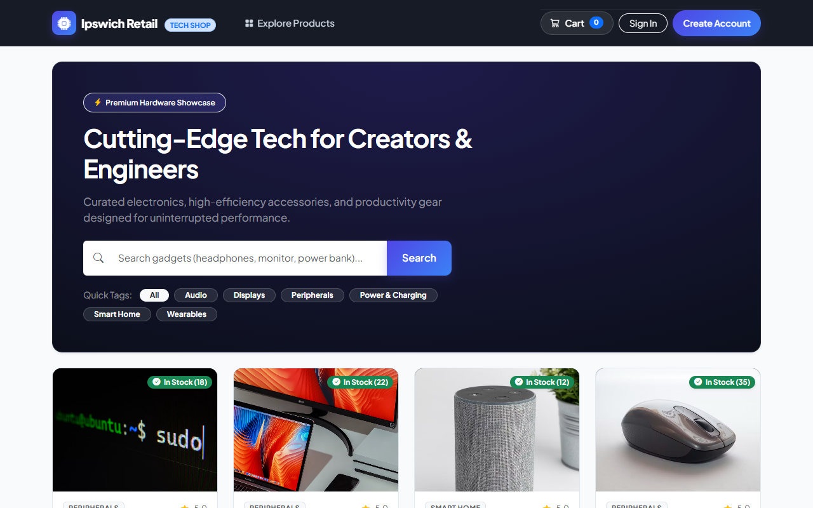
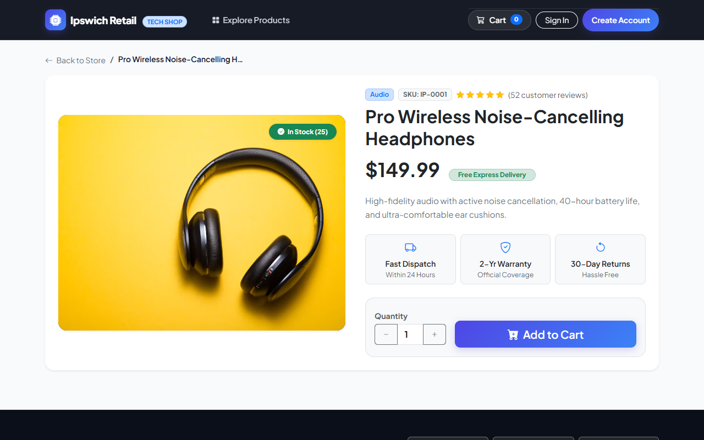
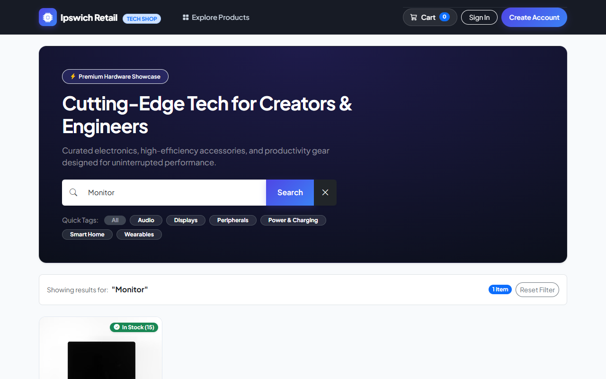
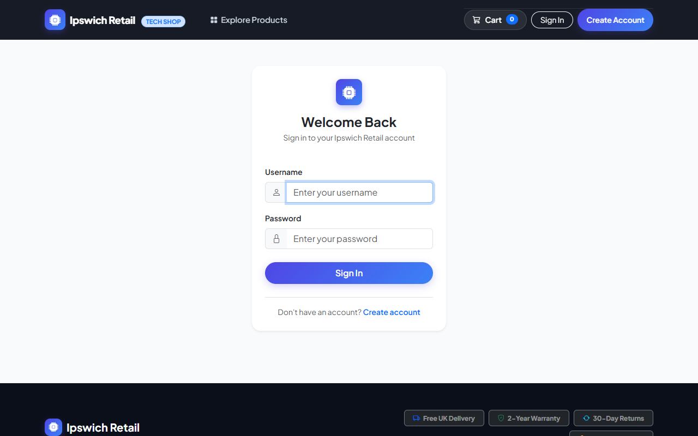

# Ipswich Retail - E-Commerce Web Application

A modern, modular Django (MVT) e-commerce web platform for cutting-edge gadgets and tech essentials, designed for reliable DevOps and containerized deployments.

---

## Key Features

### 1. Store (`store`)
- **Product Showcase:** Responsive grid displaying high-resolution gadget imagery, stock status badges, prices, and ratings.
- **Search & Quick Filters:** Live name-based search and one-tap category tags (Headphones, 4K Monitor, Keyboard, Power Bank, Smartwatch).
- **Product Detail View:** Detailed specifications, stock indicators, trust badges (2-year warranty, fast dispatch), and interactive quantity selectors.
- **Data Seeding:** Pre-seeded with 10 high-tech gadgets fixture (`python manage.py loaddata products`).

### 2. Shopping Cart (`cart`)
- **Session-Based Cart:** Stores cart state in the user's session without unnecessary database overhead.
- **Live Navbar Counter:** Context processor exposing live cart item counts across all pages.
- **Responsive Views:** Desktop table view and touch-friendly mobile card layout with quantity steppers and quick item removal.

### 3. Orders & Checkout (`orders`)
- **Transaction-Safe Checkout:** Atomic transactions ensuring inventory stock validation and automated decrements upon order placement.
- **Order Confirmation:** Printable/itemized digital receipt upon order completion.
- **Order History:** Dedicated customer portal (`/orders/history/`) displaying past purchases, items, status badges, and receipts.

### 4. Authentication (`accounts`)
- Built-in Django user registration, login, and logout views styled with modern cards and touch-friendly controls.


---

## Local Development Commands

```bash
# 1. Install dependencies
pip install -r requirements.txt

# 2. Run database migrations
python manage.py migrate

# 3. Load product fixture (10 gadgets)
python manage.py loaddata products

# 4. Start development server
python manage.py runserver

# 5. Run tests with coverage
coverage run manage.py test
coverage report

# 6. Run containerized stack
docker compose up --build
```

---

## Application Snapshots

### 1. Storefront & Product Showcase
Curated tech essentials showcase with live inventory badges, pricing, and category tags.



### 2. Product Detail View
High-resolution imagery, technical specifications, trust badges, and interactive quantity selectors.



### 3. Live Search & Category Filtering
Dynamic real-time search query matching and instant category filtering.



### 4. User Authentication Portal
Clean, modern sign-in interface for account access and order management.


